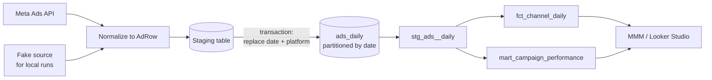

# Ad platforms → BigQuery → dbt

A small, production-shaped pipeline that pulls daily ad performance from ad platforms, loads it into BigQuery idempotently, and models it with dbt into tables that MMM and dashboards can use directly.



## Design choices

- **One schema for every platform.** Each source maps its API response into a single `AdRow` dataclass that validates itself (no negative spend, no clicks above impressions, ISO currency codes). The BigQuery schema lives next to it and an assertion fails if the two drift apart.
- **Idempotent loads.** Each run replaces exactly one `(date, platform)` slice inside a BigQuery transaction. Re-running a day never duplicates rows and never touches other platforms.
- **Lookback by default.** Platforms restate conversions for days after the fact, so a scheduled run re-pulls the last 7 days instead of only yesterday.
- **Retries where they make sense.** Rate limits (HTTP 429, Meta throttling codes) and 5xx errors back off exponentially; an invalid token fails immediately.
- **Partitioned and clustered.** The raw table is partitioned by `date` and clustered by `platform, campaign_id`, so the dbt models and dashboards scan only what they need.

## Run it locally

No credentials needed: the fake source and a SQLite target stand in for the real ones.

```bash
pip install -r requirements.txt
python -m pipeline.run --source fake --target sqlite --start 2026-01-01 --end 2026-01-31
python -m unittest discover -s tests -t .
```

## Run it against BigQuery

```bash
export META_ACCOUNT_ID=act_...  META_ACCESS_TOKEN=...
gcloud auth application-default login

python -m pipeline.run --source meta --target bigquery \
    --project my-gcp-project --dataset marketing          # last 7 days

cd dbt && dbt deps && dbt build                           # models + tests
```

A typical deployment is a daily Cloud Run job triggered by Cloud Scheduler, with the access token in Secret Manager.

## dbt models

| Model | Grain | Use |
|---|---|---|
| `stg_ads__daily` | platform × ad group × day | Typed, cleaned raw data, campaign objective parsed from the naming convention |
| `fct_channel_daily` | platform × day | Spend, conversions, CTR, CPC, CPA, ROAS. The input table for MMM |
| `mart_campaign_performance` | platform × campaign × week | Weekly KPIs with week-over-week spend change, for reporting |

dbt tests check uniqueness of each grain, accepted platform values, non-negative spend, and source freshness.

## Adding a platform

Write a class with a `platform` name and a `fetch_day(day)` method that yields `AdRow`s, then register it in `pipeline/run.py`. Nothing in the loader or the dbt models changes.

## License

MIT
